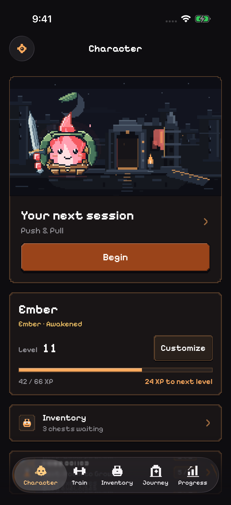
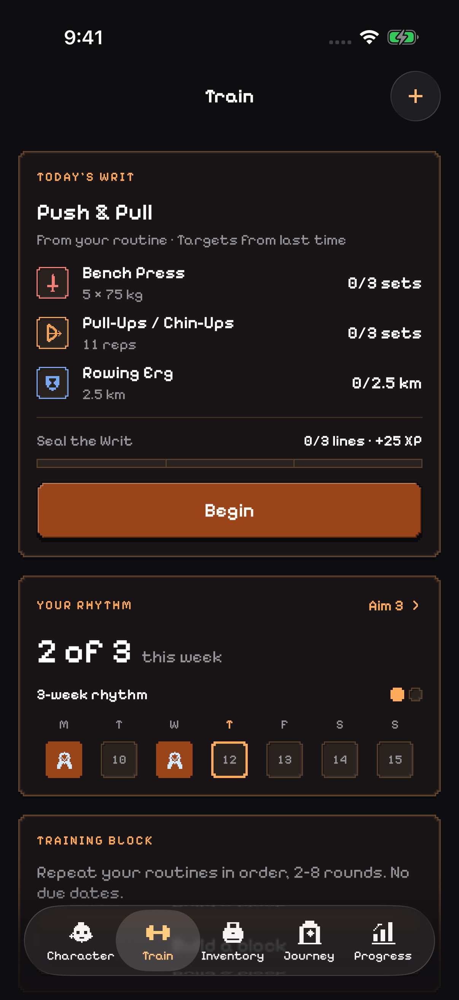
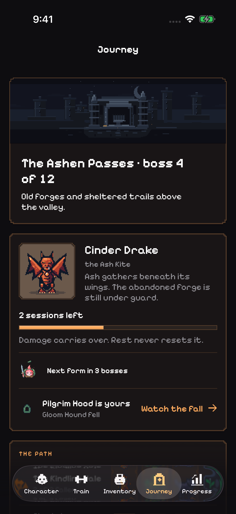

# FRPG / Liftling

> Lift real weights. Raise a creature.


**Liftling** is the current name of FRPG (formerly RPGFit): a local-first native
iPhone workout tracker where a pixel creature grows through real training.
The pre-release app centers on one creature, a weekly training rhythm, and a clear
next session. No account, ads, analytics, or paid progression are required.

**Updated November 12, 2026.** The images below show the current development app.
The source in this public repository remains the September 2026 RPGFit snapshot;
current development source is maintained separately. The original snapshot's
[feature list and run instructions](docs/public-source-snapshot.md) are preserved.

## Actual app screenshots

<p align="center">
  
  
  
</p>

These are actual captures of the running app on an iPhone 17 Pro / iOS 26.2
simulator, using a disposable profile and deterministic sample workout data.
See the [full six-screen gallery and verification notes](docs/current-development.md).

## What Liftling does today

- **Creature-led onboarding:** choose and name Ember, Sprout, Droplet, or Puff;
  select a training goal, experience level, equipment, and weekly aim.
- **A fast workout log:** per-set weight and reps, warm-ups, previous-set values,
  reusable routines, exercise guidance, pause/resume, and an automatic rest timer.
- **A weekly rhythm:** training days build toward a chosen weekly aim, with
  planned days, pause weeks, and a gentle return after a break.
- **Progress tied to real work:** training earns XP, attendance chests,
  equipment, and progress along a twelve-boss Path across four regions.
- **A useful training record:** session history, personal records, estimated
  one-rep-max and volume charts, kilogram/pound units, and CSV export.
- **Native Apple integration:** SwiftUI, Charts, WidgetKit, ActivityKit,
  optional HealthKit workout export, and manual CloudKit backup.
- **Local-first storage:** no account or tracking; export, backup, and Health
  access are explicit choices. The 1.0 target is iPhone in portrait orientation.

The app remains in development. Older RPGFit systems such as classes, coins,
familiars, and expeditions are hidden in the current 1.0 interface while existing
data is retained. These screenshots do not announce an App Store release.

## Run the public source snapshot

The checked-in September source supports iPhone and iPad on iOS/iPadOS 18.5+.
It uses Swift 5 language mode and Apple frameworks, with no package dependencies.
Open `RPGFitMVP.xcodeproj` with Xcode 26.3 and select the `RPGFitMVP` scheme.

```bash
git clone https://github.com/devon4899/FRPG.git
cd FRPG
open RPGFitMVP.xcodeproj
```

Simulator builds do not need provisioning. For physical devices, choose your own
development team and replace the bundle, app-group, and iCloud container
identifiers with identifiers that team owns. See the
[snapshot documentation](docs/public-source-snapshot.md) for test commands,
architecture, and the original feature list.

## Privacy, support, and license

Workout and creature data stay local unless the user explicitly exports it,
requests a backup, or enables optional Health access. See the
[privacy policy](https://devon4899.github.io/rpgfit-site/privacy.html) and
[support page](https://devon4899.github.io/rpgfit-site/support.html).

This repository does not grant an open-source license. Source is public for
review; reuse and redistribution require the copyright holder's permission
unless a license is added later. Read [CONTRIBUTING.md](CONTRIBUTING.md) and
[SECURITY.md](SECURITY.md) before contributing or reporting a security issue.
