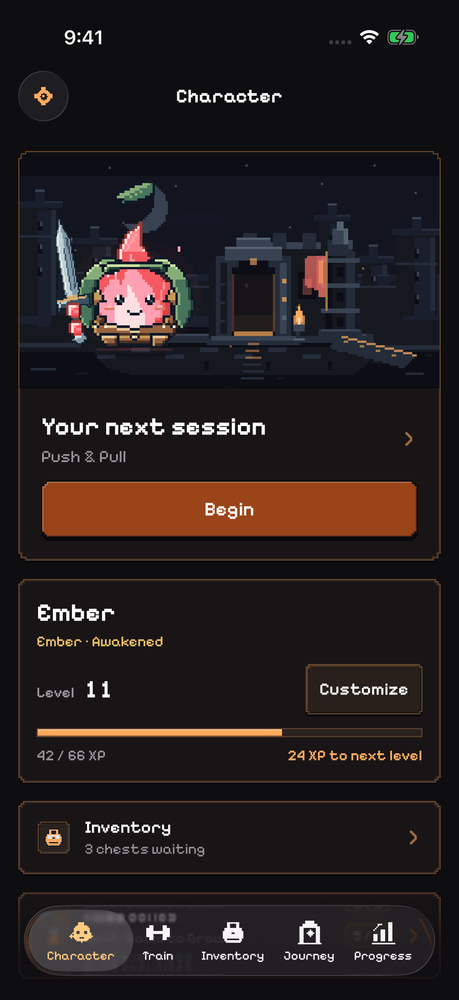
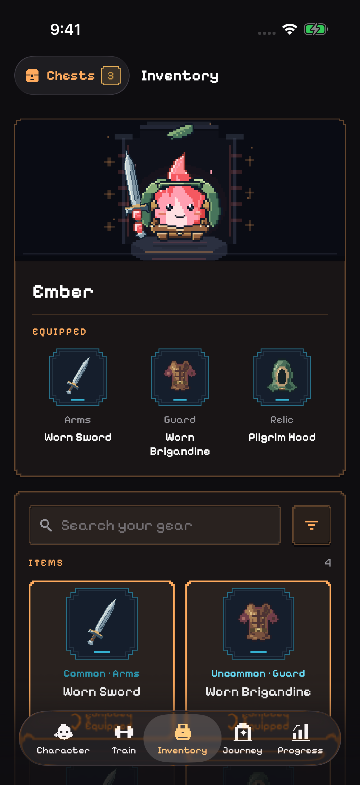
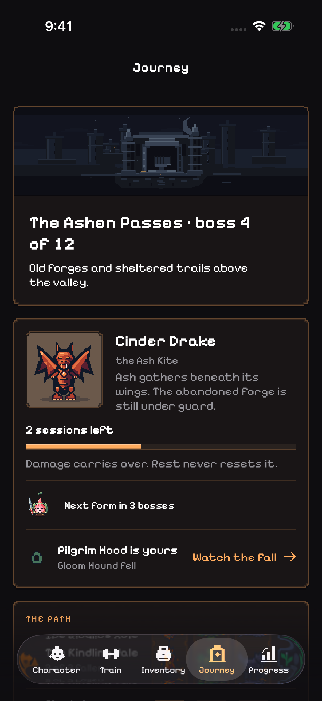
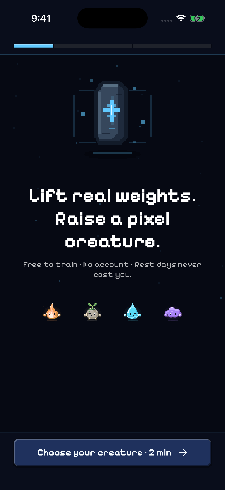
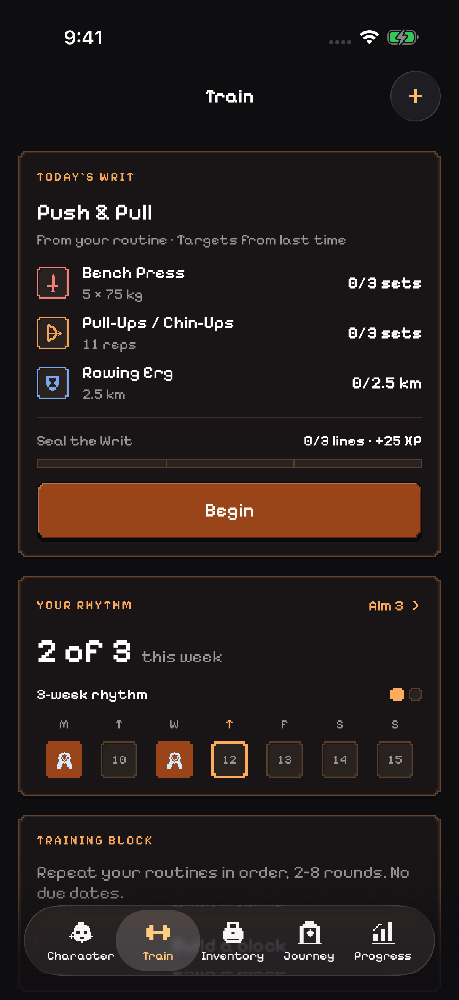
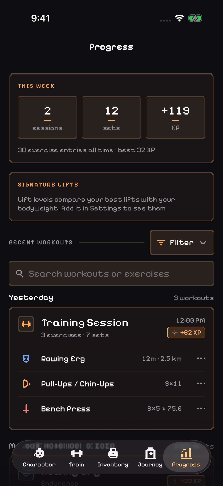

# Liftling / FRPG — current development

Updated November 12, 2026.

Liftling is the current name and direction of FRPG, a native iPhone workout log
with a pixel creature whose progress comes from real training. The active app
focuses on a weekly training rhythm, a direct session launcher, set logging,
attendance rewards, and a twelve-boss Path. It is pre-release software.

## Real app captures

These images were captured from the running native app, not rendered mockups.
They use a fresh disposable iPhone 17 Pro simulator on iOS 26.2, built with
Xcode 26.3. The onboarding image is a fresh-install screen; the other images use
the app's deterministic screenshot fixture with sample workout history. The
1.0 feature flags are in their default state; legacy systems are not enabled in
these images. The status bar is normalized to 9:41.

| Screen | What it shows |
| --- | --- |
| [Onboarding](screenshots/current/00-onboarding.png) | The current promise and four original pixel creatures |
| [Character](screenshots/current/01-character.png) | The creature, training scene, and next session |
| [Inventory](screenshots/current/02-inventory.png) | Visible gear, earned items, and chests |
| [Journey](screenshots/current/03-journey.png) | Training-powered progression along the Path |
| [Train](screenshots/current/04-train.png) | Weekly rhythm, session start, and routines |
| [Progress](screenshots/current/05-progress.png) | Weekly totals and recent workout history |

  
  
  

  
  
  

## Implementation

SwiftUI and Swift domain models, with Apple Charts, WidgetKit, ActivityKit,
HealthKit, CloudKit, and UserNotifications. There are no third-party package
or analytics dependencies. Workout and creature data are stored locally;
exports, Health access, and manual cloud backups are optional.

## Verification and source boundary

The app and both test targets built successfully for iOS Simulator with
`xcodebuild build-for-testing` and code signing disabled. Captures come from
the existing default-surface UI walkthrough (`CutListUITests`) and `simctl`.
The complete default-surface and legacy-restoration walkthrough passed: one UI
test, zero failures. All six published screenshots were visually reviewed.
This pass did not rerun the full unit suite or validate device-only services.

The public repository's source remains the September 2026 RPGFit snapshot;
these images show the newer Liftling development build. The current source
checkout was at `f0ba21c` with pre-existing local localization and test updates.
No source from the private development repository is published by this
visual refresh. No App Store release or physical-device service validation is
implied by this simulator review.
